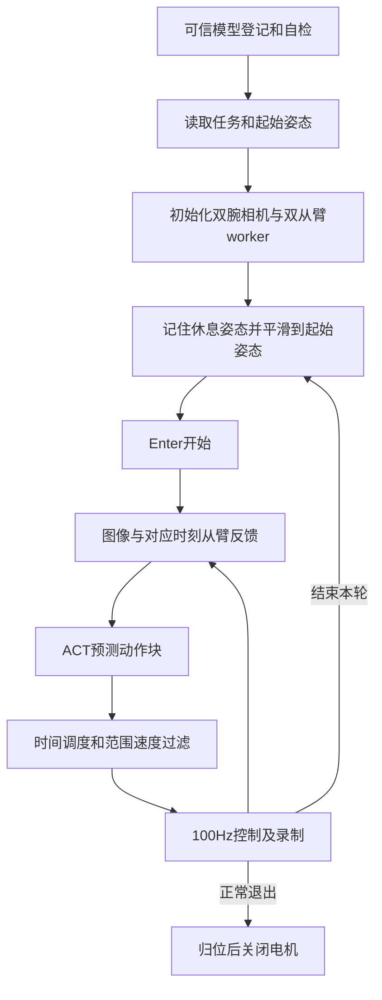

# 黄块任务的程序结构

来源和许可集中见[主README](README.md#代码来源与许可)。

| 模块 | 职责 |
|---|---|
| `project/yam_infer/run.py` | 生命周期、键盘、对齐、运行、记录和收尾 |
| `policy/` | checkpoint合同、预处理、归一化、ACT网络和动作还原 |
| `control/state_history.py` | 按图像时刻插值状态 |
| `control/scheduler.py` | 动作块调度、淡化、范围和速度过滤 |
| `hw/arms.py`、`hw/follower/` | session、RPC、反馈与命令看门狗 |
| `data/` | 相机、预测、下发与实测的可复盘记录 |
| `training/` | 数据审计、完整episode划分和独立训练 |

模型按checkpoint的camera_names顺序读取双腕480×640 RGB，保留训练一致的JPEG处理、图像标准化和qpos归一化。delta输出反归一化后向全部14维加同一次观测qpos，包括夹爪；不能混用其他权重格式的动作表示。

100步动作块按30Hz从原图像时刻调度，每60步重规划、0.1秒淡化。推理耗时对应的旧目标自然跳过，不在结果返回后重新播放第0步；控制仍以100Hz下发，底层保护保留。

起始姿态来自同一模型的start_pose；启动和正常退出归位都会运动。程序使用启动实测休息姿态，不能假定任意悬空姿态断力后稳定。`q`及Ctrl+C是归位流程而非急停。

本次整理调整文档、单任务配置入口与测试样例，未改网络、控制计算或保护。真实部署前须重新自检；离线合成测试不证明真实抓取成功。
