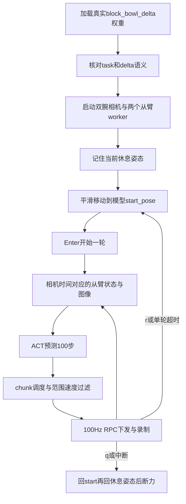

# GitHub源码学习：与黄块／红盒子任务对应

源码基准：[FuFutheBest/yam_infer 固定提交](https://github.com/FuFutheBest/yam_infer/tree/bb2e8aba33d6bd9bcba43c2ffca129ad90c3feb5)。本包`project/`保留源码与原文档，新增安装、自检和本地启动包装，正常运行仍调用原`yam_infer.run`。

## 从启动到退出

## 文件职责与实际语义

| 文件 | 核对内容 |
|---|---|
| `run.py` | 解析配置、构造Policy／相机／从臂、平滑回位、Enter/r/q、每轮记录、归位收尾 |
| `config.py` | 严格校验models.yaml和run.yaml，拒绝任务、格式和动作模式不一致 |
| `policy/policy.py` | 识别act_v2与act_ref、训练一致的JPEG预处理、状态归一化、动作反归一化 |
| `policy/act_ref.py`与`policy/detr/` | 官方ACT结构，图像ImageNet标准化，推理latent置零、FP32，不下载ImageNet初始化权重 |
| `control/state_history.py` | 100Hz反馈缓冲，在两相机平均到达时刻插值得到观测状态 |
| `control/scheduler.py` | chunk承诺执行或ensemble，按原图像时刻插值，交叉淡化和目标范围／速度限制 |
| `hw/arms.py` | 双臂session、seq、RPC、目标保持心跳、worker启动与关闭 |
| `hw/follower/runtime.py` | 旧帧、命令租约、跟随误差、反馈与I/O卡死看门狗 |
| `hw/follower/endpoints.py`与`worker.py` | 从臂7维接口，绑定CAN和portal，测试端点明确使用fake |
| `third_party/i2rt/` | 驱动、夹爪、CAN、机器人机械模型、SDK底层限位；保留原许可证 |
| `data/` | NEDF3兼容MCAP，帧序号、policy输入输出、下发与实测、缺流录制隔离 |
| `tools/replay_policy.py` | 按cam_seq重建当时真正输入，重跑网络并与记录比较 |
| `tools/free_hw.py`、`home_arms.py` | 前者可能终止占用／重置CAN，后者会移动；本包安装过程不运行硬件模式 |

## 不能混用的动作与时间

黄块模型为`yam_train/act_ref-v1`。按checkpoint的`camera_names`顺序（此前记录是右腕再左腕）输入480×640 RGB图像；经过录制一致的JPEG q90往返、除255和ImageNet标准化。qpos按训练`qpos_mean/std`归一化，网络输出用`action_mean/std`还原。

**原框架delta分支把全部14维都加回该次观测qpos，包括夹爪。** 不能把之前LeRobot权重“关节相对、夹爪绝对”的转换搬过来。两种权重即使都是ACT，也不是相同网络结构、分辨率、归一化或动作语义。

原仓库默认运行horizon30；本次黄块配置horizon60、blend0.1秒、40秒单轮上限来自之前已读取的实际部署记录，单独保存在`target_task.json`，不修改网络代码。ACT预测100步、30Hz，约执行2秒后重新规划。chunk时间线从图像时刻开始，推理延迟跳过过时目标；不能返回后重新从第0步播放。

## 起始姿态和停止的正确理解

起始姿态来自**同一个真实模型的start_pose**，不是随意设定角度或另一权重的起始值。`smooth_move`用三次smoothstep，按距离和速度计算时间，至少2秒；目标合法不等于路径已经做了碰撞规划。主程序启动时的实测姿态被当成退出休息姿态，因此启动前要按实验室原流程摆妥。

原`SafetyFilter`按示范范围加margin裁剪关节目标、夹爪裁剪[0,1]并限速；SDK还执行机械限位。它不是旧包严格反馈拒绝＋0.15rad总位移封套，也不能证明工作空间不会碰撞。本包复制原行为，没有简单删除旧包代码来伪装成功。

原`park_and_release`会在退出时回起始和休息姿态；故障时会尝试reset并重新接管归位。因此`q`和Ctrl+C不是紧急停止。`home_arms`也是会动的恢复工具，不应作为无硬件自检。

## 验证证据边界

本地CPU实际通过43项GitHub测试，覆盖模型格式、ACTRef推理、反归一化、图像处理、录制、调度、状态历史、配置和worker看门狗。另对黄块专用任务选择器做测试，确保蓝杯、香蕉、LeRobot、abs和随机测试模型被拒绝。

`tools/offline_demo.py`使用仓库自带随机模型生成器、生成JPEG录制与SimArms，走原main的对齐、Enter、推理、超时、归位、q退出。该测试模型标记为`reproduction_test_only`，不能注册为真实模型，也不能证明黄色物块抓取成功。测试模型及生成录制不打包成部署权重。

GitHub没有真实训练权重；本包不会因此声称“已完成黄块真实模型推理”。现场`setup_yellow_red.sh`只读复制现有权重，锁定哈希、核对task并运行CUDA合成输入检查；要证明真实抓取仍须现场完成一轮并查看日志／视频。更严格的历史预测回放需要录制数据，当前GitHub中也未包含。

本包保留GitHub源码许可证；`SEVERS.md`中原本出现的登录密码已在分发副本脱敏，此文档变化不影响运行。原始源码清单和本地修改清单均在`evidence/`。
